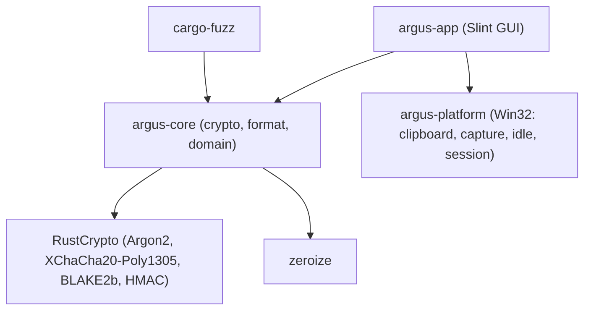

# Argus Vault — Product Requirements Document (PRD)

> **Scope of this document:** *what* Argus Vault must do and *why* (requirements, threat model,
> specifications). *How* and *when* it gets built — phases, tasks, status and acceptance criteria —
> lives in [`PLAN_DE_IMPLEMENTACION.md`](PLAN_DE_IMPLEMENTACION.md), which is the single source of
> truth for progress. Do not duplicate status here.

---

## 1. Executive Summary & Vision

**Argus Vault** is an offline, zero-trust desktop password manager for Windows written in **Rust**
with a native GUI built with **Slint**.

Its core premise is **attack-surface minimization and auditability**:

- **Zero-vulnerability goal:** no network code (air-gapped by design), no `unsafe` outside a single
  audited platform crate, a small and audited dependency set, zero telemetry, and strict memory
  hygiene for secrets. "0 CVE" is a design goal, not a guarantee; it is pursued through the controls
  in §2.2 and verified continuously (tests, fuzzing, `cargo-deny`).
- **Auditable, deterministic architecture:** a simple encrypted format built on RustCrypto
  primitives (Argon2id, XChaCha20-Poly1305, BLAKE2b), no legacy formats, no C runtimes.
- **Native, minimalist UX:** permanent dark theme, low resource footprint, no distractions.

---

## 2. Product Requirements

### 2.1 Target Platform & Environment

- **Operating system:** Windows 10 / 11 (x86_64). Screen-capture exclusion requires Windows 10
  version 2004 or later (see §3.8).
- **Network footprint:** strictly **zero** network access. No HTTP clients, DNS resolvers, socket
  libraries, IPC listeners or analytics.
- **Execution model:** standalone desktop application, single instance per vault, crash-safe local
  persistence.

### 2.2 Threat Model

#### In scope

| Threat | Mitigation |
|---|---|
| **Remote attacks / RCE** | No network code. `cargo-deny` bans networking and TLS crates (`reqwest`, `hyper`, `tokio`, `curl`, `openssl`, …). |
| **Offline brute force of a stolen vault** | Argon2id calibrated per machine (at least 512 MiB, t=4, p=4), optional keyfile, minimum master password length of 10 characters. |
| **Ciphertext tampering & KDF downgrade** | XChaCha20-Poly1305 authenticates payload and the full header (salt, nonce, KDF params) as AAD. KDF parameters have a hard floor (64 MiB, t=2) and a hard ceiling (2 GiB, t=64, p=16). |
| **Secrets in memory after use** | Secret-bearing types implement `Zeroize`/`ZeroizeOnDrop`; growable buffers wipe old allocations (`SecureBuf`); `Debug` output is redacted. Limits: see "Known limitations". |
| **Supply chain** | Exact dependency versions locked in `Cargo.lock` and enforced with `--locked`; compiler pinned in `rust-toolchain.toml`; `cargo-deny` checks advisories, licenses, sources and bans. |
| **Crash corruption / data loss** | Atomic writes (`.tmp` → fsync → copy previous file to `.bak` → rename). |
| **Old credentials still opening a backup** | On credential change, `.bak` is replaced with the re-keyed vault (or removed if that fails). |
| **Clipboard snooping, history and cloud sync** | Clipboard formats `ExcludeClipboardContentFromMonitorProcessing`, `CanIncludeInClipboardHistory = 0` and `CanUploadToCloudClipboard = 0`; auto-clear after a configurable delay (default 20 s) only if the clipboard still holds that same copy (see §3.7). |
| **Screen capture / recording** | `SetWindowDisplayAffinity(WDA_EXCLUDEFROMCAPTURE)`, falling back to `WDA_MONITOR` on older builds. |
| **Unattended unlocked vault** | Auto-lock on inactivity, on minimize, on Windows session lock and on suspend/hibernate. |
| **Information leak through errors** | Wrong password, wrong keyfile and tampered file all report the same coarse error. |

#### Out of scope (explicitly)

- Malware running as the same user or as administrator (keyloggers, debuggers, memory scrapers).
  Once the machine is compromised, no desktop password manager can protect an unlocked vault.
- Physical attacks on a running, unlocked machine.
- Hardware side channels (power, EM, cache timing on shared hosts).

#### Known limitations (documented, not hidden)

- **Swap, hibernation and crash dumps:** process memory may be written to `pagefile.sys`,
  `hiberfil.sys` or a crash dump. Argus does not lock memory pages. Users are advised to enable
  BitLocker. Excluding the process from Windows Error Reporting dumps is under evaluation.
- **UI framework strings:** text shown in or typed into Slint widgets (including the master password
  field) is held in `SharedString`, which is not wiped. Exposure is minimized by the rules in §4.1.
- **Deleted files:** removing `.tmp`/`.bak` files does not securely erase them from SSDs; only
  ciphertext is ever written, so this exposes old *encrypted* versions only.
- **Rename durability:** `std::fs::rename` uses `MoveFileExW(MOVEFILE_REPLACE_EXISTING)` without
  `MOVEFILE_WRITE_THROUGH`; after a power loss the previous version may be the one on disk (never a
  corrupted mix).
- **Crafted-file DoS:** a malicious header can request up to 2 GiB of Argon2 memory before
  authentication fails. Accepted trade-off to allow strong parameters.

---

## 3. Core Features & Specifications (MVP)

### 3.1 Vault Storage & Cryptography

1. **Key derivation:**
   ```text
   pw_hash = BLAKE2b-512("argus/v1/password" || len(pw) || pw)
   kf_hash = BLAKE2b-512("argus/v1/keyfile"  || len(kf) || kf)   (or 64 zero bytes)
   master  = Argon2id v1.3(pw_hash || kf_hash, salt[32], m, t, p) -> 32 bytes
   enc_key = BLAKE2b-MAC-256(key = master, "argus/v1/enc")
   ```
   - Costs for a new vault (or after a credential change) are **calibrated to the creating machine**:
     the largest memory size (64 MiB to 2 GiB, powers of two) that fits in a quarter of the memory
     that is free right now **and** keeps the minimum number of passes under 2 s; then the passes
     (4 to 10) are raised until one derivation takes about 1.5 s. The result is never below the
     default (512 MiB, t=4, p=4) unless the machine lacks the free memory for it: then the costs are
     reduced to what fits and the UI tells the user the vault is weaker than usual. Free memory means
     the smaller of free physical memory and remaining commit, so the key buffers are not paged out.
   - **Opening is checked, not calibrated.** The costs live in the authenticated header. Before
     deriving the key, the app reads them (without decrypting) and requires the memory Argon2 needs
     plus a quarter to be free; otherwise it shows "needs about N MiB of free memory" instead of
     attempting it, because an allocation failure aborts the process. Vaults created with the
     earlier default (256 MiB, t=3) keep opening.
   - The password is **Unicode NFC-normalized** before hashing (already-NFC input is hashed in
     place without a copy), so the same text typed with different input methods (precomposed vs.
     combining accents) always opens the same vault. The keyfile is hashed as raw bytes.
2. **Authenticated encryption:** XChaCha20-Poly1305, fresh random 24-byte nonce on every save,
   16-byte tag, full 83-byte header as AAD.
3. **File layout (`.argus`, 83-byte header):** magic `ARGUSV01`, version `u16`, KDF id, `m`/`t`/`p`,
   salt (32 B), nonce (24 B), ciphertext length (4 B), then ciphertext.
4. **Inner payload:** hand-written TLV with strict validation (bounds-checked, no panics, unknown
   tags and duplicate fields rejected, unique entry ids), padded to 4 KiB blocks to hide the exact
   vault size.
5. **Format versioning:** the outer format (`ARGUSV01` header, `version: u16`) and the inner TLV
   payload (`INNER_VERSION: u16`) carry independent versions.
   - A file with an unknown version is rejected with `UnsupportedVersion` and is never partially
     parsed; the version field is covered by the AAD, so it cannot be altered without detection.
   - Any change to the KDF, the cipher or the header layout bumps the outer version. Any change to
     the TLV records bumps the inner version; adding optional fields inside a record does not
     (decoders reject unknown tags, so new tags always require a bump).
   - A future version N+1 must keep reading version N and, after a successful unlock, re-save the
     vault in the new format (one-way migration). The previous file is preserved as `.bak` by the
     normal atomic write, so a failed or unwanted migration can be rolled back by hand.
   - Version 1 is frozen once the first release is published; until then, changes to v1 are allowed.
   - Inner version 2 (2026-10-16) adds the entry kind (`0x0A`) and host (`0x0B`) tags. Version 1
     payloads are still read (every entry becomes a website) and are re-saved as version 2; version 2
     requires the kind on every entry and rejects unknown kind codes.

### 3.2 Keyfile Support

- Generated keyfiles are 64 bytes from the OS CSPRNG (`BCryptGenRandom` via `getrandom`), saved as
  `.argkey`. Generation never overwrites an existing file.
- Any existing file from 1 byte to 16 MiB may be used as a keyfile.
- The UI must warn, when a keyfile is set, that **losing the keyfile means losing the vault**.

### 3.3 Credential Management

- Fields: title (required), username, password, URL, secure notes, TOTP configuration.
- **Site icons:** websites show a bundled brand icon when the URL or title matches one of 50 known
  sites and self-hosted tools. Icons are single-colour SVGs compiled into the program; nothing is
  fetched, so the offline guarantee holds. Lookalike hosts get no icon.
- Entry ids: random 128-bit values. Timestamps: 64-bit Unix seconds (created / modified).
- Limits: 1 MiB per text field, 100 000 entries, 64 MiB plaintext.
- **Entry types (current scope):** for now the product targets exactly two kinds of credential.
  1. **Server (RDP):** a host/server plus username and password. The dominant use is *open the
     entry and copy the password*, so Copy is the primary action and must be reachable in one
     click from the list and from the detail view.
  2. **Website:** title, URL, username and password (the current entry shape).

  Other entry kinds (notes, cards, identities) are out of scope until these two are solid. The
  type is chosen when creating an entry and shown in the list; search covers the host/URL too.

### 3.4 Password & Passphrase Generator

- **Character passwords:** length 8–128; lowercase, uppercase, digits, symbols; optional exclusion
  of ambiguous characters (`Il1O0o`). Rejection sampling (no modulo bias); every selected class is
  guaranteed to appear.
- **Passphrases:** 4–20 words from the embedded EFF Large Wordlist (7 776 words, SHA-256 verified);
  custom separator, capitalization, optional digit.

### 3.5 Built-in Authenticator (TOTP)

- RFC 6238 / RFC 4226; SHA-1, SHA-256, SHA-512; 6–8 digits; period 1–300 s.
- Input: bare Base32 secret or `otpauth://totp/...` URI.
- Live countdown in the UI.

### 3.6 In-Memory Search

- Case-insensitive match on title, username and URL. Passwords and notes are never searched.
- No index or plaintext written to disk; temporary lowercase copies are wiped.

### 3.7 Auto-Lock & Clipboard Hygiene

- **Auto-lock:** inactivity timeout (30 s – 2 h, default 5 min), lock on minimize (default on),
  lock on Windows session lock, remote/console disconnect and suspend/hibernate. Inactivity is
  measured across the whole Windows session (`GetLastInputInfo`), so working in another program
  counts as activity. A locked window is repainted when restored from minimized: Slint does not
  do it by itself, which would leave the last vault frame on screen.
- **Clipboard:** a copied secret carries the three protection formats plus a private
  `ArgusVaultCopyId` format holding a unique, non-secret identifier. It is cleared after 5–300 s
  (default 20 s), on lock and on exit, **only if that identifier is still on the clipboard**, i.e.
  nothing else has been copied since; newer content from other programs is left alone. The secret is
  never read back. The check and the clear run with the clipboard held open, and a busy clipboard is
  retried after 2 s. `GetClipboardSequenceNumber` is deliberately not used: it moves by a variable
  amount when the clipboard is closed (measured +3 for these formats), so a value captured around
  the copy is unreliable and a wrong one would make the auto-clear silently do nothing. Known
  limits: the format name reveals that Argus Vault made the copy, and if the process is killed
  abruptly nothing clears the clipboard.

### 3.8 Screen-Capture Protection

- `WDA_EXCLUDEFROMCAPTURE` on Windows 10 2004+; `WDA_MONITOR` (black window in captures) otherwise.
- Applied as soon as Slint creates the native window, which happens once the event loop runs; the
  window can be visible for a few milliseconds before that (unlock screen only). If protection
  cannot be applied, the unlock screen says so.

### 3.9 Import (MVP) / Export (post-MVP)

- Import from KeePass CSV and Bitwarden unencrypted JSON. After import, the UI reminds the user to
  delete the plaintext source file. Only logins are imported (Bitwarden notes, cards and identities
  are skipped and counted); entries become websites. Encrypted Bitwarden exports are refused.
- Encrypted export / plaintext export are post-MVP.

### 3.10 Concurrency

- One process per vault: a named mutex derived from the normalized vault path prevents two
  instances from writing the same file (otherwise the last writer silently wins). It is taken
  before key derivation and released on lock. It lives in the per-session `Local\` namespace, so
  a second window in another Windows session is not detected.

---

## 4. UI/UX Specifications (Slint)

- **Look:** permanent dark theme (`#0E1014` background, `#161A20` surfaces, `#4FD1C5` accent);
  Inter or Segoe UI.
- **Screens:**
  1. **Unlock:** master password, keyfile picker, "Create new vault", reveal toggle, strength meter
     (for new vaults).
  2. **Vault view:** sidebar with search, entry count and list; detail panel with title, masked
     password + copy, username, TOTP code with progress ring, URL, notes.
  3. **Entry editor:** all fields, generator shortcut, TOTP secret / URI import.
  4. **Generator:** length slider, class toggles, entropy bar.
  5. **Settings:** auto-lock, clipboard delay, change password / keyfile.
- **Responsiveness:** key derivation (~1 s with defaults) runs off the UI thread with a progress
  indicator; the UI never freezes during unlock or save.

### 4.1 Handling Secrets in the UI

1. The entry list model contains **only** non-secret fields (title, username, URL). Passwords,
   notes and TOTP secrets are never loaded into list models.
2. A secret is pushed to a Slint property only while it is being revealed or edited, and the
   property is cleared as soon as the reveal/edit ends or the vault locks.
3. Copying a secret goes **only** through `argus-platform` (protected clipboard formats). Native
   copy is disabled on password and secret fields: Slint's `input-type: password` masks the text
   but does **not** block Ctrl+C / Ctrl+X (verified by running the app), so secret fields swallow
   Ctrl+C, Ctrl+X, Ctrl+Insert and Shift+Delete before the text input sees them. Revealed secrets
   are shown in plain `Text`, which is not selectable.
4. The master password field is cleared immediately after the unlock attempt.

---

## 5. Technical Architecture



- **`argus-core`:** pure logic, `#![forbid(unsafe_code)]`, no UI, no I/O beyond the vault and
  keyfile files.
- **`argus-platform`:** the **only** crate allowed to use `unsafe` (Win32 calls through Microsoft's
  `windows` crate). Every `unsafe` block carries a `// SAFETY:` comment, enforced with
  `clippy::undocumented_unsafe_blocks` and `unsafe_op_in_unsafe_fn`. The workspace lint table does
  not set `unsafe_code` at all: each crate sets its own level (`forbid` in `argus-core`, `deny` in
  `argus-app`, documented `allow` here).
- **`argus-app`:** Slint UI with `#![deny(unsafe_code)]`. It cannot be `forbid`: the Rust code
  Slint generates contains `unsafe` (item-tree vtables) and opts in with a local `allow`. `deny`
  still makes any `unsafe` in the hand-written code a compile error, and the generated code is
  isolated in its own module.
- **Licensing:** Argus Vault is released under **GPL-3.0-only** (see `LICENSE`), which is also the
  Slint option used (Slint is "GPL-3.0-only OR royalty-free OR commercial").
- **Slint dependencies:** default features are disabled (`std`, `compat-1-2`, `backend-winit`,
  `renderer-software`). Measured on 2026-10-15: 254 unique runtime crates in `argus-app` versus 34
  in `argus-core`, with no networking crates. `webbrowser`, `arboard` and the image/SVG parsers are
  still linked; trimming them is a Phase 5 task.

The folder layout and build tooling are described in the implementation plan.
